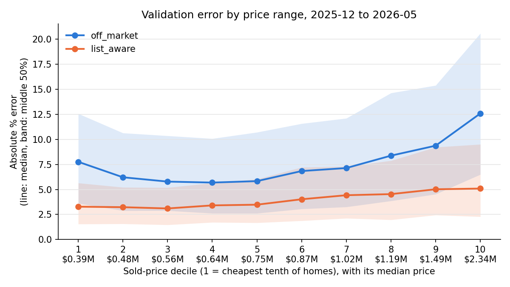

# Validation report

Walk-forward validation, 2025-12 to 2026-05: each month was predicted by models trained only on the sales before it.
Errors are (predicted - sold) / sold. Brackets: bootstrap 95% interval.

| Track | Homes | MAPE | MdAPE | Median signed error |
|---|---|---|---|---|
| off_market | 10,069 | 9.44% (9.28 to 9.61) | 7.31% (7.14 to 7.50) | +1.38% |
| list_aware | 10,069 | 4.88% (4.80 to 4.97) | 3.81% (3.73 to 3.91) | -0.11% |

MAPE: mean absolute percentage error. MdAPE: median absolute percentage error.
A median signed error above 0 means the model tends to predict too high.
The intervals treat homes as independent. Homes sold in the same month share the same
market swings, so the real uncertainty is somewhat wider.

## Seasonal backtests (train before June 1, predict June to September)

| Season | Track | Homes | MdAPE | MAPE | Median signed error |
|---|---|---|---|---|---|
| 2023 | list_aware | 8,302 | 4.55% | 5.65% | +0.53% |
| 2023 | off_market | 8,302 | 6.62% | 8.88% | +0.93% |
| 2024 | list_aware | 7,630 | 4.27% | 5.34% | +0.28% |
| 2024 | off_market | 7,630 | 6.64% | 8.96% | +1.54% |
| 2025 (held back) | list_aware | 8,052 | 3.85% | 4.88% | -0.00% |
| 2025 (held back) | off_market | 8,052 | 6.84% | 9.08% | +0.91% |

### off_market, 2025 season

80% range from earlier seasons covers 79.5% of homes (target 80%); median width 22.6% of the price.

| Property type | Homes | MdAPE | Median signed error | In 80% range |
|---|---|---|---|---|
| Co-Op Apt | 50 | 8.46% | +2.85% | 80.0% |
| Condo Apt | 3,623 | 5.54% | +1.45% | 80.4% |
| Condo Townhouse | 554 | 5.63% | -0.02% | 79.1% |
| Detached | 2,683 | 8.73% | +1.00% | 78.8% |
| Freehold Townhouse | 292 | 8.42% | +2.09% | 76.4% |
| Semi-Detached | 850 | 8.39% | -2.12% | 79.1% |

MdAPE by predicted-price tenth (1 = cheapest; grouped by prediction, not sale price, so noise in the sale does not exaggerate the pattern): 1: 5.1%, 2: 5.3%, 3: 5.2%, 4: 5.5%, 5: 6.6%, 6: 7.8%, 7: 7.4%, 8: 8.2%, 9: 9.1%, 10: 10.5%

### list_aware, 2025 season

80% range from earlier seasons covers 85.3% of homes (target 80%); median width 16.7% of the price.

| Property type | Homes | MdAPE | Median signed error | In 80% range |
|---|---|---|---|---|
| Co-Op Apt | 50 | 3.53% | +0.98% | 86.0% |
| Condo Apt | 3,623 | 3.14% | -0.61% | 87.7% |
| Condo Townhouse | 554 | 3.59% | +0.29% | 85.4% |
| Detached | 2,683 | 4.63% | +0.98% | 84.9% |
| Freehold Townhouse | 292 | 4.70% | +0.67% | 79.5% |
| Semi-Detached | 850 | 5.40% | +0.11% | 78.0% |

MdAPE by predicted-price tenth (1 = cheapest; grouped by prediction, not sale price, so noise in the sale does not exaggerate the pattern): 1: 3.1%, 2: 3.2%, 3: 3.2%, 4: 3.3%, 5: 4.0%, 6: 4.2%, 7: 4.5%, 8: 4.3%, 9: 4.8%, 10: 4.9%